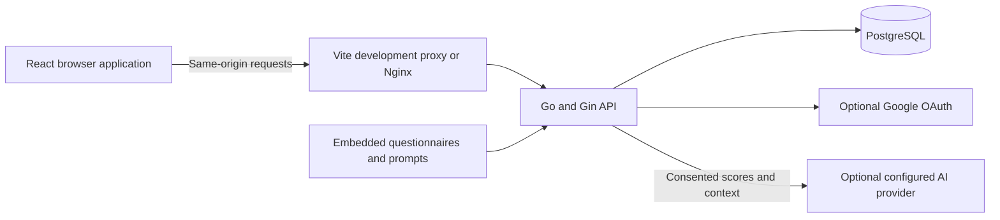
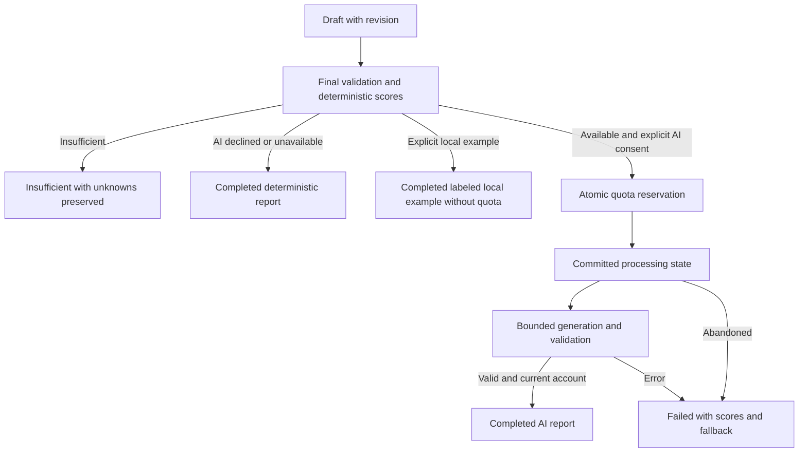

# Architecture, API, database, and security

Source review date: **2026-10-14**. This document describes the implementation in this checkout. Runtime results and unexecuted checks belong in [Development verification](04-development.md#verification-results). Installation/configuration belong in the [User guide](02-user-guide.md), scope in [Overview](01-overview.md), and remaining decisions in [Decisions](05-decisions.md).

## System context and runtime

Relations is a React/TypeScript browser application backed by one Go/Gin process and PostgreSQL. It implements accounts, profiles, original bilingual questionnaires, saved drafts, deterministic scoring, local example reports, optional live AI narratives, history, and administrative operations. External generation is synchronous and bounded; there is no queue or background generation worker. Periodic maintenance recovers abandoned processing and removes eligible expired authentication records.

Startup needs PostgreSQL, a JWT secret, and a 32-byte base64 encryption key. A provider API key is optional: deterministic results and local examples work without one. Google needs all three Google settings. Source implementation and offline fixtures do not establish live OAuth or paid-provider operation.

### Startup and executables

| Entry point | Behavior |
| --- | --- |
| `backend/cmd/server` | Validate process environment; connect; migrate; seed immutable questionnaires and eligible default accounts; initialize absent settings; recover stale processing; start HTTP and periodic maintenance |
| `server migrate` | Perform database/catalog/settings/recovery/authentication-cleanup initialization, then exit; it does not seed default accounts or open HTTP |
| `backend/cmd/seed-admin` | Validate configuration; connect; migrate; explicitly initialize the first admin without resetting/promoting an existing account |

Go does not load `.env` automatically. [Scripts](../scripts/) provide explicit environment loading, secret setup, backend startup, verification, and backup helpers. Setup preserves existing files and does not create a PostgreSQL role/database. `SEED_DEFAULT_ACCOUNTS` defaults true in development/test and false in production. When enabled, startup initializes missing admin/user roles using configured credentials without changing existing accounts. The separate seed-admin command remains available for explicit first-admin initialization.

### Development default accounts

| Role | Default email | Default password |
| --- | --- | --- |
| Administrator | `admin@relations.local` | `RelationsAdmin2026!` |
| Ordinary user | `user@relations.local` | `RelationsUser2026!` |

`ADMIN_EMAIL`/`ADMIN_PASSWORD` and `USER_EMAIL`/`USER_PASSWORD` override these development values. Seeding checks whether any account of each role exists, including disabled accounts; it inserts only the missing role in one transaction. It never promotes, resets or updates an existing account. An email already owned by another account causes `409/default_email_unavailable` and rolls back the complete default-initialization transaction. New default profiles use age `max(30,MIN_AGE)` and gender prefer_not_to_say so the local workflows can be exercised immediately.

Production configuration and the seeding service reject the public default passwords. Disabling seeding does not delete or rotate previously created development accounts. Use a separately prepared production database or intentionally change/erase development accounts before exposing their data. These published passwords are convenience credentials, not private deployment secrets.

Startup database work shares a 30-second deadline. HTTP uses a 5-second header timeout, 15-second read timeout, 3-minute write timeout, 60-second idle timeout, and 16,384-byte header bound. Readiness has a 2-second database-ping deadline; shutdown waits up to 10 seconds. Analysis recovery runs every minute with a 10-second context and at most 100 stale records per pass. Authentication cleanup has its own 5-second bound and batches up to 500 records of each eligible type, retaining expired refresh ancestors while their family has a live child.

Evidence: [server](../backend/cmd/server/main.go), [configuration](../backend/internal/config/config.go), [default-account service](../backend/internal/auth/defaults.go), [maintenance](../backend/internal/maintenance/service.go), [seed command](../backend/cmd/seed-admin/main.go).

### Container topology

[Compose](../docker-compose.yml) supplies three services on a private `172.30.0.0/24` network:

| Service | Network and storage |
| --- | --- |
| `frontend` | Nginx at `172.30.0.10:8080`; serves the SPA and proxies `/api/`; publishes `${WEB_BIND_ADDR:-127.0.0.1}:${WEB_PORT:-5173}:8080` |
| `backend` | Go at `172.30.0.20:8080`; no host port; trusts proxy `172.30.0.10`; waits for database health |
| `database` | PostgreSQL at `172.30.0.30:5432`; no host port; persistent `postgres_data` volume; health check |

Backend/frontend run as non-root users with read-only roots, temporary `/tmp`, dropped capabilities, and `no-new-privileges`. Nginx replaces forwarded client-IP headers with the connection's remote address and supports SPA deep links. Frontend health checks the proxied API readiness endpoint. Browser API requests stay on the frontend origin in Vite and Compose.

Backend images use Go 1.27.1 Alpine and Alpine 3.22.1; frontend uses Node 24 Alpine and `nginx:stable-alpine`; PostgreSQL is 17.11 Alpine. Definitions are not executed-container evidence. Supplied ingress is HTTP; public HTTPS termination remains operator work. Updating must preserve the database volume.

Evidence: [backend Dockerfile](../backend/Dockerfile), [frontend Dockerfile](../frontend/Dockerfile), [Nginx](../frontend/nginx.conf), [Compose](../docker-compose.yml).

## Source responsibilities

| Source area | Responsibility |
| --- | --- |
| [config](../backend/internal/config/config.go) | Environment validation/defaults, production URL/cookie/DB policy, proxy allowlist, optional Google |
| [httpapi](../backend/internal/httpapi/router.go) | Routes, headers/logs, CORS/Origin, cookies, strict decoding, envelopes |
| [auth](../backend/internal/auth/service.go) | Accounts, eligible profiles, bcrypt, sessions/JWT/refresh, OAuth, seed and self-erasure |
| [database](../backend/internal/database/database.go) | Pool, explicit constrained models/JSONB, checksum migrations, development rollback |
| [questionnaire](../backend/internal/questionnaire/catalog.go) | Embedded banks/public projections, typed answers/context, immutable seeding |
| [scoring](../backend/internal/scoring/scoring.go) | Deterministic dimension and descriptive similarity arithmetic |
| [analysis](../backend/internal/analysis/service.go) | Owner drafts/history/reports, revisions, final validation, separate consent, quotas and recovery |
| [ai](../backend/internal/ai/service.go) | Encrypted configuration, fixed-host adapters, finite prompts, bounded retry/report validation/testing |
| [admin](../backend/internal/admin/service.go) | Real aggregates, restricted users/erasure, limits and audits |
| [maintenance](../backend/internal/maintenance/service.go) | Bounded expired-authentication cleanup preserving live refresh-family replay detection |
| [platform](../backend/internal/platform/errors.go) | Safe errors, strict JSON, pagination and process-local throttles |
| [frontend](../frontend/src/main.tsx) | React routing/state, questionnaires, score tables/bars, reports/history/admin, language/theme |

## Frontend and browser boundaries

Browser routes are `/login`, `/register`, `/auth/callback`, `/`, `/history`, `/account`, `/reflect/:module`, `/analyses/:id/edit`, `/analyses/:id`, and `/admin`. The shell gates private screens; the backend independently enforces current-account/owner/admin authorization.

The API client uses relative `/api/v1`, same-origin cookies, and an access token in module memory. Page startup restores a session through the HttpOnly refresh cookie. A pending promise prevents concurrent refresh in one tab; Web Locks serialize session changes across supporting tabs; BroadcastChannel propagates logout. Without Web Locks, clients can still encounter strict refresh-replay races. Only language/theme preferences go in localStorage; tokens/answers/reports do not.

Refresh rejection with HTTP 401 clears the memory token and dispatches logout, including proactive renewal before a request. Network errors and server failures surface to the caller without clearing the session; the pending refresh is released so another attempt can run. A retried authenticated request that still returns 401 also clears the session. Incorrect password reauthentication is returned to the form without a refresh loop.

Locale defaults to `fa` with RTL and supports `en` with LTR. Theme defaults to browser preference. Wizards show six items per page, retain unknowns, save snapshots, review responses and require educational consent. Optional external AI sharing is a separate unchecked choice when a live provider is active. Local examples are labeled as examples and require no external-sharing consent. Dirty changes trigger debounced saving and unload/navigation protection. Resume restores answers and chooses the first unfinished question/context page or review when complete; the previous page index is not separately persisted.

Results use one-decimal display, numeric completeness, unknown counts, textual tables/bars/null gaps, similarity coverage and browser print/save-PDF. Changing UI language does not translate an already-saved report narrative. React renders report text without injected HTML. Failed/insufficient records can return to the wizard for review/edit and resubmission; failed results also offer deterministic completion. The API supports a separately consented AI retry.

Evidence: [API](../frontend/src/api.ts), [auth state](../frontend/src/auth.tsx), [routes](../frontend/src/main.tsx), [wizard](../frontend/src/pages/Wizard.tsx), [results](../frontend/src/pages/Results.tsx), [preferences](../frontend/src/i18n.tsx).

## HTTP API

### Shared behavior

All paths below have prefix `/api/v1`. Success JSON is `{ "data": ... }`; errors are `{ "error": { "code": "stable_code", "message": "safe message" } }`. Analysis deletion returns `204` without JSON. OAuth redirects. Unmapped errors become `500/internal_error`; raw provider errors are not exposed.

JSON requests require `Content-Type: application/json`. Declared/actual bodies are bounded to 65,536 bytes. Strict typed decoding rejects unknown fields, nested duplicates, trailing content, depth beyond 64, and incompatible types. Declared oversize returns `413/request_too_large`; decode failures `400/invalid_request`; wrong media types `415/unsupported_media_type`.

CORS permits absent Origin but rejects supplied origins outside the exact allowlist. Cookie and administrative mutations additionally require nonempty trusted Origin, including CLI requests. Allowed preflight methods are `GET, POST, PATCH, PUT, DELETE, OPTIONS`, headers `Authorization, Content-Type`; no wildcard origin.

`Bearer` means a currently valid access token. `Profile` means eligible age/supported nonempty gender. `Admin` means current database role. List envelopes are `{items,total,page,page_size}`; defaults page 1/size 20; bounds page 1..100000 and size 1..100.

### Health, accounts, and questionnaires

| Method and path | Input / result | Policy |
| --- | --- | --- |
| `GET /health/live` | `{status:"alive"}` | Public |
| `GET /health/ready` | `{status:"ready"}`; failed ping `503/not_ready` | Public |
| `GET /auth/config` | `{google_enabled,minimum_age}` | Public |
| `POST /auth/register` | `{email,password,name}`; `201`, session/cookie | Trusted Origin; registration throttle |
| `POST /auth/login` | `{email,password}`; session/cookie | Trusted Origin; IP/email throttles |
| `POST /auth/refresh` | Refresh cookie; replacement session/cookie | Trusted Origin; rotating refresh |
| `POST /auth/logout` | Refresh cookie; `{logged_out:true}` | Trusted Origin; absent/unrecognized cookie idempotent |
| `POST /auth/logout-all` | `{logged_out:true}`; revoke sessions/expire cookie | Bearer; trusted Origin |
| `GET /auth/google` | Google redirect/state or safe login error | Optional Google; throttle |
| `GET /auth/google/callback` | Valid query/state; refresh cookie/frontend redirect | Cookie state, single-use state, PKCE, verified identity |
| `GET /users/me` | Current user | Bearer |
| `PATCH /users/me` | Complete `{name,age,gender}`; updated user | Bearer; all fields valid |
| `POST /users/me/password` | `{current_password,new_password}`; `{password_changed:true,login_required:true}` | Bearer; trusted Origin; current password; revoke sessions |
| `DELETE /users/me` | `{password}`; `{deleted:true}` | Bearer; trusted Origin; ordinary password account |
| `GET /questionnaires/:module` | Optional `version=1.0.0`, `locale=fa|en`; public bilingual bank | Public; module self/compatibility/conflict |

Session JSON includes access token/expiry/user, excluding refresh/password hashes. User JSON includes identity/profile/role/disabled, optional daily limit and timestamps. Clients cannot choose roles/owners. Public banks omit reverse keys/rationale/internal references; locale validation retains both languages.

Emails are trimmed/lowercased plain addresses up to 254 bytes; names trimmed UTF-8 1..120 runes without NUL/CR/LF; passwords 12..72 UTF-8 bytes and nonblank. Age is configured minimum through 120; genders female/male/nonbinary/other/prefer_not_to_say. Main errors include invalid_credentials, invalid_account/email/name/gender, profile_required, age_ineligible, password_account_required, reauthentication_unavailable and questionnaire_not_found.

Evidence: [auth routes](../backend/internal/httpapi/auth.go), [Google routes](../backend/internal/httpapi/google.go), [questionnaires](../backend/internal/httpapi/questionnaire.go).

### Analyses

| Method and path | Input / result | Policy and main errors |
| --- | --- | --- |
| `POST /analyses` | `{module,locale?,questionnaire_version?,answers?,context?}`; `201`, full draft | Bearer + Profile; defaults fa/1.0.0; draft_limit at 100 active drafts |
| `GET /analyses` | Optional module/status/pagination; summary page | Bearer; own rows; excludes answers/context/scores/report |
| `GET /analyses/usage` | `{day,user_used,user_limit,global_used,global_limit,report_available,provider,is_example}` | Bearer; UTC/current limits/provider mode |
| `GET /analyses/:id` | Full own analysis | Bearer; analysis_not_found for malformed/missing/foreign ID |
| `PATCH /analyses/:id` | `{revision,answers,context,locale?}`; full updated analysis | Bearer + Profile; whole objects; revision_conflict; draft/failed/insufficient only |
| `POST /analyses/:id/submit` | `{revision,consent,generate_report?,ai_consent?,local_example?}`; persisted full result | Bearer + Profile; educational consent true; generation defaults false; live generation requires AI consent; explicit local example has no external sharing |
| `GET /analyses/:id/report` | Full own analysis/report/scores | Bearer; report_not_ready for draft/processing/no report |
| `DELETE /analyses/:id` | `204` without body | Bearer; own row; analysis_processing blocks active deletion |

Full analyses include module/locale/version tuple, status/revision, object answers/context/scores/report, educational/AI-consent timestamps, provider/model/prompt/schema/failure metadata and lifecycle timestamps. Owner UUID is excluded from JSON. Completed records are immutable. Failed/insufficient records can retry with current revision or edit back to draft.

PATCH requires non-null answers/context objects, replaces both, increments revision, and resets previous score/report/failure/provider/consent state. Stale saves cannot overwrite newer answers. Final submission separately requires every required item key and required context; explicit null still counts as an answered unknown choice.

An attempted provider failure is HTTP 200 with persisted failed status, scores, deterministic fallback and safe failure_code. Admission quota errors are HTTP 429 global_daily_limit/user_daily_limit with no committed partial reservation/state; local scoring remains available by submitting generate_report false. No active provider produces deterministic results without an external attempt. For an available scoring result, explicit `generate_report:true,local_example:true` selects a pure local example regardless of a concurrently changed live configuration; it uses no external request, AI-sharing timestamp, processing state or generation quota. Insufficient results retain deterministic reports and insufficient status even when a local example was requested. `local_example:true` with `generate_report:false` returns `400/invalid_request`.

Evidence: [routes](../backend/internal/httpapi/analyses.go), [DTOs](../backend/internal/analysis/types.go), [service](../backend/internal/analysis/service.go), [quota/recovery](../backend/internal/analysis/quota.go).

### Administration

All routes require Bearer + Admin. Mutations additionally require trusted Origin; user/provider/limit mutations share 30/minute/IP and connection tests have separate 3/minute/IP throttles.

| Method and path | Input / result | Constraints |
| --- | --- | --- |
| `GET /admin/analytics` | Optional days 1..90/default 30; real counts, UTC series, module/provider/token aggregates and today's counter | No private answers/reports |
| `GET /admin/users` | Optional q up to 120 runes/pagination; narrow user views | Escaped literal name/email search; no hashes/demographics/answers |
| `PATCH /admin/users/:id` | `{disabled?:boolean,daily_limit?:integer|null}`; updated view | At least one field; limit 1..10000/null default; no self/admin/role edits |
| `DELETE /admin/users/:id` | `{current_password,confirm_email}`; `{deleted:true}` | Current password-admin reauthentication; exact target email; ordinary target including Google-only |
| `GET /admin/provider` | Provider/model/key-presence/settings/active/timestamp/is_example view | No plaintext or encrypted key returned |
| `PUT /admin/provider` | `{provider,model,api_key?,max_tokens,timeout_seconds,retries,active}`; safe view | Live activation/switch needs key; mock is key-free and clears stored key |
| `POST /admin/provider/test` | Empty object `{}`; `{success,provider,model,latency_ms}` | External connection request; audited; outside analysis quotas; mock returns local_provider |
| `POST /admin/provider/preview` | `{module,locale?,answers?,context?}`; local scores/example report/mode and sample-input flags | Admin + trusted Origin; mutation throttle; no external call, generation quota or sharing consent; sanitized audit only |
| `GET /admin/limits` | `{global_daily,user_daily}` | Persisted row; initialize only when absent |
| `PUT /admin/limits` | `{global_daily,user_daily}` | Global 1..1000000/default user 1..10000; audited |
| `GET /admin/audit` | Paginated operational events | Sanitized metadata may retain deleted-account UUID |

Disabled-state changes revoke refresh sessions/increment account version; re-enabling cannot restore them. Admin accounts cannot be changed/erased here; no promotion API. Admin erasure deletes sensitive dependents/per-user counters with password and email confirmation.

Analytics use actual rows. Account/analysis totals are current all-time counts; generation/token series use requested range. Active users means non-disabled, not recently logged-in. Generation-event totals include successful local example events with provider mock and zero tokens; they are not counts of paid external calls. Usage-event totals can also differ from admitted counters while processing/interrupted. Admin previews create audit events rather than generation events. No currency-cost estimate exists.

Evidence: [routes](../backend/internal/httpapi/admin.go), [admin service](../backend/internal/admin/service.go), [provider service](../backend/internal/ai/service.go).

## Authentication and session invariants

Passwords use bcrypt cost 12 and unknown accounts undergo dummy comparison; generic credential errors cover wrong password/disabled/Google-only password login. Registration chooses user role.

Access JWTs use HS256, issuer relations-manager/audience relations-web, checked algorithm/issuer/audience/expiry/issued-at/not-before/token ID, positive version and UUID subject/session. Every request checks current DB user/session owner, version, disabled/expiry/revocation; roles come from DB.

Refresh values use 32 random bytes/43 URL-safe characters; DB stores SHA-256 only. User-first locking precedes session locking. Atomic rotation marks used/inserts replacement; reuse commits whole-family revocation even on error. Ordinary refresh does not itself revoke old access until expiry; logout/replay revoke family; logout-all/password change revoke all and increment version. Cleanup preserves expired ancestors while a family has a live child, so replay protection survives retention.

Cookies are host-only HttpOnly/Lax, path `/api/v1/auth`, name rm_refresh or __Secure-rm_refresh; production requires HTTPS public/allowed origins and secure cookies. JWT secret replacement rejects old access but does not revoke stored refresh families.

Google uses official OAuth/ID-token libraries, hashed single-use five-minute state/nonce, PKCE, state-cookie binding, signatures/claims and fixed frontend redirect destinations. Subject identifies account; matching email never implicitly links. Live credentials/callback acceptance remains separate.

Self-erasure requires current password and excludes admins. Google-only users need administrator-assisted erasure because fresh-Google self-reauthentication is absent. Admin erasure rechecks current password/role and target email. First-admin seed is explicit/idempotent, with no account promotion/reset.

Evidence: [tokens](../backend/internal/auth/tokens.go), [repository](../backend/internal/auth/repository.go), [Google](../backend/internal/auth/google.go), [admin erasure](../backend/internal/admin/service.go), [cleanup](../backend/internal/maintenance/service.go).

## Database

Embedded SQL is authoritative; no AutoMigrate. The migrator takes an advisory transaction lock, sorts migrations, verifies applied SHA-256 checksums, and applies new files/ledger rows transactionally. Applied history is immutable. RollbackLast is a development helper, not production CLI.

Migrations are [0001 foundation](../backend/migrations/0001_foundation.up.sql), [0002 domain](../backend/migrations/0002_domain.up.sql), [0003 AI consent](../backend/migrations/0003_analysis.up.sql), and [0004 local provider mode](../backend/migrations/0004_ai_mode.up.sql), with down partners. The third adds ai_consent_at and requires it for processing. The fourth extends provider constraints to mock, permits active key-free mock and prohibits storing key bytes for mock. Its down migration refuses rollback while any mock provider/analysis/usage rows exist, preserving their meaning. App code supplies UUIDs; timestamps use timestamptz, daily day is date, JSONB fields are objects rather than encoded strings.

| Table | Use and constraints |
| --- | --- |
| schema_migrations | Version/checksum/applied ledger |
| app_settings | Singleton id 1; positive global/default-user limits; absent-only initialization |
| users | Unique normalized email, user/admin role, optional eligible age/gender, disabled/limit/auth version |
| auth_identities | Google subject; unique provider/subject and user/provider; user cascade |
| refresh_sessions | Hashed sessions/families/use/expiry/revocation; user cascade |
| oauth_states | Hashed state/nonce, PKCE verifier and flow expiry |
| questionnaires | Module/version composite key, scoring tuple, immutable object definition; referenced versions restrict deletion |
| analyses | Owner/module/locale/version/status/revision, object answer/context/scores/report, consent/provider/failure/lifecycle; user cascade |
| daily_usage | UTC day/scope composite key; nonnegative global and user:uuid counters |
| usage_events | Sanitized attempt provider/model/status/error/latency/tokens; nullable user/analysis IDs on deletion |
| provider_config | Singleton id 1; live or mock mode/model/settings; versioned encrypted key; active live mode requires key; updater nullable |
| audit_events | Actor/target/action/object operational metadata; references nullable on erasure |

Completed analyses need report; processing/completed need educational consent; processing also needs AI consent. Constraints complement owner predicates/services rather than authorize access. Indexes cover owner history, activity/processing, session family/owner/expiry, OAuth expiry, usage aggregates and audit history.

Analysis deletion removes answers/context/scores/report and clears related usage analysis IDs. Account deletion cascades identities/sessions/analyses, deletes all user counters, and clears nullable event/updater foreign keys. Global counts survive. Admin-erasure metadata can retain a deleted UUID; email/password/narratives are not copied there. No automatic age-based report/audit/quota-row deletion policy is set.

The pool allows 20 open/five idle connections with 30-minute lifetime; startup/readiness pings are bounded and SQL logging silenced. See [database](../backend/internal/database/database.go), [models](../backend/internal/database/models.go), and [Development](04-development.md) for backup/restore.

## Questionnaire and scoring contracts

The finite catalog has self with 36 items and 10 dimensions, compatibility with 32 items per respondent, 15 dimensions and 2 context fields, and conflict with 15 items, 5 dimensions and 8 context fields. Questionnaire/scoring version is 1.0.0 only. Seed compares canonical definition hashes/version; editing applied content fails startup. Adding files alone does not implement historical retrieval/scoring dispatch.

Answers are respondent-to-item-to-nullable-integer, for example `{"self":{"o1":4,"o2":null}}`. Integers are 1..5; present null is unknown; absent is omitted. Partner is compatibility-only. Reverse score is 6-x; unknown/omitted never impute zero/neutral.

For n items, numeric sufficiency is `max(2,ceil(2*n/3))`, implemented exactly as `max(2,(2*n+2)/3)`. Sufficient score is `25*(mean keyed numeric-1)`, ranging from 0 to 100. Unrounded bands are lower below 40, middle from 40 through 60, and higher above 60. Insufficient score/band stay null; completeness is numeric answers divided by all items, with separate unknown/omitted counts. Display rounding does not alter persisted arithmetic.

Self availability needs three sufficient dimensions; conflict can be available through required context even with all style scores null. Compatibility averages 100-abs(scoreA-scoreB) over sufficient common dimensions only with at least three, independent origin and asserted partner consent. Otherwise index is null, preserving coverage/individual scores. Similarity is not relationship-success probability.

Compatibility context uses independent/proxy origin and partner_consent; these are assertions, not authenticated partners. Unconsented/proxy results are insufficient and not sent to AI. Conflict requires relationship_type (colleague/parent/friend/partner/other), safety (yes/no/unknown), and nonblank topic; optional narratives cap 2,000 runes without NUL. Typed context rejects module-incompatible fields even empty/false.

Original construct-inspired questions are not licensed clinical instruments. Reliability, clinical validity, norms and language equivalence remain unknown. References motivate constructs, not validation. Exact formulas/research catalog are in [Development](04-development.md).

Evidence: [catalog](../backend/internal/questionnaire/catalog.go), [validation](../backend/internal/questionnaire/validation.go), [context](../backend/internal/questionnaire/context.go), [scoring](../backend/internal/scoring/scoring.go).

## Analysis lifecycle and quotas

Transactions lock current user before owned analysis. Submission checks revision/final answers/context, computes/stores scores, educational consent, and deterministic/example/insufficient/processing state. External or legacy normal provider attempts additionally record ai_consent_at. Network work follows committed reservations outside DB locks. Explicit local examples use the pure generator inside the transaction, atomically save the labeled report and zero-token event, and leave ai_consent_at/processing time null.

Admission locks UTC global then user counters and increments both atomically. Persisted defaults initialize from environment only when absent; per-user override replaces default. Rejecting the second counter rolls back the first/state. Failed admitted attempts remain consumed; retries fit one attempt. Deterministic, insufficient and no-provider outcomes consume no quota. Explicit local examples also bypass admission and persist locally with zero token metrics; admin previews/connection tests are separate. A legacy normal submission to a configured mock can still follow the standard consent/quota path, while the browser selects the explicit free local path.

Finalization has a separate 10-second context even after HTTP cancellation. It rechecks owner/state/revision and account disabled/auth-version before storing narrative. Deletion cannot resurrect records. Disabled/version-changed accounts receive no new AI narrative; operational failure persists when possible and HTTP returns unauthorized. Ordinary single-family logout is enforced on later requests and does not change account version.

Recovery fails processing older than `max(3 minutes, AI_TIMEOUT*(AI_RETRIES+1)+1 minute)` with processing_interrupted, clears processing time, increments revision, preserves scores/fallback, and writes one error event without refund. Provider retries share one timeout of at most 120 seconds, below the threshold. Late results cannot overwrite recovered state.

## AI providers, prompts, and reports

### Configuration and encryption

One mode is selected: openai, deepseek, anthropic, gemini or mock. Live model format is `^[A-Za-z0-9][A-Za-z0-9._:-]{0,127}$`; it is not a live supported-model catalog. Availability, permissions and output support need provider-specific verification. Settings allow 512..16000 tokens, a timeout of 1..120 seconds and 0..3 retries. Live keys must be non-whitespace printable ASCII of 10..2048 bytes. Mock uses local-example-v1 and needs no API key; activation is an explicit administrator choice, not an automatic startup default.

Live keys use AES-256-GCM, fresh nonce, version byte and column-bound associated data. They remain server-side; views expose presence only. An omitted replacement preserves the same live provider's key; switching to a live provider requires a new one. Selecting mock clears the encrypted key. An inactive live provider can be connection-tested; local preview is separate and cannot call it.

### Local examples and preview

Mock reports are deterministic local templates with `kind:"example"`, explicit localized example notices and exact echoes of computed scores. They are not generated by an external model and are never presented as successful live AI calls. Zero token metrics and provider mock distinguish them in usage. The external-provider timeout/retry/model settings do not create network activity for mock. The preview locale defaults to fa.

The administrator preview is independent of saved provider configuration. It never reads a live key or invokes an outbound adapter, even when a live provider is active. Its response contains provider mock, model local-example-v1, is_example true, external_request false, used_sample_answers, used_sample_context, computed scores, example report, prompt_version local-example-1.0.0, report_schema 1.0.0 and latency_ms 0. It creates no analysis/quota reservation; only module/locale/provider/example/sample-input flags are stored in the audit metadata, without supplied answers/context/report.

Omitted preview answers use labeled synthetic all-3 responses; supplied maps, including an empty object, preserve nulls and omissions and undergo draft validation. Omitted context supplies a sample independent/consenting compatibility assertion, or a conflict friend/unknown-safety/sample scheduling topic. Supplied context is validated normally, and explicit null answers/context are rejected. Sample-input flags disclose which defaults were used. Sample scores are arithmetic on these inputs, not fabricated measurements of the signed-in user. Preview needs neither educational nor external-sharing consent because it does not persist a personal analysis or transmit data externally.

Changing AI_ENCRYPTION_KEY does not re-encrypt existing credentials. Preserve it for recovery or replace provider keys intentionally. This feature encrypts the provider key, not answers/reports/backups or all database fields.

### Network adapters

| Provider | Fixed endpoint and mode |
| --- | --- |
| OpenAI | `https://api.openai.com/v1/chat/completions`; strict JSON Schema; store false; Bearer key |
| DeepSeek | `https://api.deepseek.com/chat/completions`; JSON-object plus local validation |
| Anthropic | `https://api.anthropic.com/v1/messages`; JSON Schema output; API-key/version headers |
| Gemini | `https://generativelanguage.googleapis.com/v1beta/models/<model>:generateContent`; structured JSON; API-key header |

Arbitrary hosts/redirects are refused. The transport response cap is 1 MiB and report content cap is 64 KiB. Truncation, refusal and invalid finish markers fail generation. Network, HTTP 429 and server failures permit bounded retries/backoff within one timeout; permanent errors/invalid reports do not trigger another-provider fallback. Provider error bodies are discarded rather than logged/returned.

### Prompts and validation

Six embedded module/locale prompts combine with common trusted instructions. The JSON data envelope separates untrusted context from system instructions: module/locale, deterministic scores, supplied context, expected echoes, allowed references and schema. Identity/email/age/gender/password/raw Likert maps are not transmitted by generation.

Prompts require educational/nonvalidated framing, unknown-data limits, plain text, no invented scores/norms, and supportive conflict caution. No/unknown safety forbids confrontation/scripts. Instructions and structural checks reduce risks but do not guarantee scientific correctness, semantic safety or prompt-injection immunity.

Report required fields are kind, schema_version 1.0.0, module, locale, title, summary, sections, recommendations, limitations, references, score_echo and safety. External output must use `kind:"ai"`; local templates use `kind:"example"`. Sections contain id/title/body; safety contains level routine/caution, message and support. Local validation rejects wrong/unknown/missing fields, duplicates, module/locale mismatch, excessive text/counts, duplicate section IDs, unavailable references and altered/missing/extra echoes. Every respondent/dimension nullable score must exactly match deterministic source. Conflict no/unknown requires caution and nonempty support.

Reference IDs are bfi2, attachment, emotion_regulation, emotion_awareness, communication, conflict_styles, relationship_similarity, further restricted to the selected bank. ID validation does not establish narrative truth. Numeric prose and recommendation meaning are instructed, not fully semantically verified.

Deterministic report fields are kind/source deterministic, schema_version 1.0.0, module/locale, localized title/summary/limitations, ai_available, and optional static caution for conflict no/unknown. No invented narrative replaces source scores. Saved provider/model/prompt/schema identify AI output. Failures retain fallback and safe ai_timeout, ai_rate_limited, ai_provider_error, ai_invalid_report or ai_unavailable codes.

Evidence: [service](../backend/internal/ai/service.go), [local examples/preview](../backend/internal/ai/example.go), [adapters](../backend/internal/ai/provider.go), [crypto](../backend/internal/ai/crypto.go), [prompts](../backend/internal/ai/prompts.go), [validator](../backend/internal/ai/report.go), [report types](../backend/internal/analysis/types.go).

## Security controls and gaps

| Area | Implemented boundary |
| --- | --- |
| Authentication | Bcrypt/generic failure; current sessions/version/role; hashed rotating refresh/replay revocation |
| Ownership | Authenticated owner predicates; separate current-admin authorization |
| Browser | Exact Origin, HttpOnly cookies, memory JWT, same-origin proxy, bounded trusted proxy |
| Input | Strict typed bounded JSON/context, duplicate/depth checks, revisions |
| AI privacy/cost | Separate sharing consent, partner suppression, atomic attempt quotas, fixed hosts, encrypted server key |
| Output | Finite prompts/schema/echo/reference/bounds/safety-shape; plain-text rendering |
| Operations | Audits, aggregate analytics, stale/expired-auth cleanup, migrations/deletion cascades |
| Headers/logs | IDs/nosniff/frame/referrer/permissions/no-store; production HSTS; Nginx CSP; route/status/latency without body/cookie/key dumps |

Auth/admin throttles are process-local rather than distributed. Generation quotas are attempt budgets rather than hard token/currency caps; retries/tests matter. Explicit local examples/previews make no outbound requests and consume no generation quota. Partner consent/origin remain assertions.

Operators still need storage protection, provider processing/retention review, report/audit policy, recovery ownership and restoration tests. No email verification, password recovery, account linking, invitations, fresh-Google self-erasure, encryption-key rotation workflow or MFA exists. Admins have no answer/report browsing endpoint, but DB operators can access stored data.

CI and verification/browser test sources exist. A workflow/configuration/test does not establish executed remote CI, Docker, native Linux, live Google/provider or public HTTPS success. See [Development verification](04-development.md#verification-results) for exact evidence.
